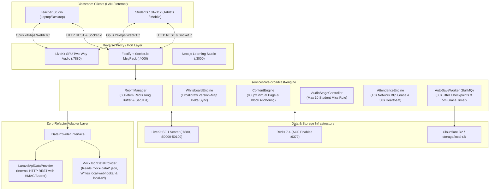

# Real-Time Learning Page Broadcasting & Attendance Microservice

> **Principal System Architecture & Full-Stack Implementation Guide**  
> Horizontally scalable, fault-tolerant broadcasting and attendance engine designed for Ubuntu Linux, PM2 Cluster Mode, Docker Compose, and LAN mobile/laptop testing (`0.0.0.0`).

---

## 1. System Architecture & Adapter Pattern Overview

The system is built on a clean **Data Provider & Auth Adapter Pattern** controlled by an environment variable:

```bash
DATA_SOURCE_MODE="mock_json" | "laravel_api"
```



---

## 2. Mathematical Coordinate Models & Engines

### Formula A: Content Mode — 800px Virtual Page Scaling & Block-ID Anchoring
Never broadcast raw screen pixel positions. All content is placed in an $800\text{ px}$ logical container.

1. **Virtual Logical Container Width:**
   $$W_{\text{virtual}} = 800\text{ px}$$

2. **CSS Transform Scaling Factor on Device:**
   $$S_{\text{content}} = \frac{W_{\text{device}}}{800}$$

3. **Scroll Sync (Block-ID Anchoring):**
   $$\text{blockOffsetRatio} = \frac{\text{scrollTop}_{\text{teacher}} - \text{blockTop}}{\text{blockHeight}} \in [0, 1]$$

4. **Virtual Space Pen & Laser Pointer Coordinates:**
   $$X_{\text{screen}} = X_v \times S_{\text{content}}, \quad Y_{\text{screen}} = (\text{blockTop}_{\text{student}} + Y_v) \times S_{\text{content}}$$
   *Guarantee: A circle drawn around a word or a laser pointer aimed at a formula lands on the exact same letter on any screen.*

---

### Formula B: Excalidraw Infinite Canvas — Viewport Auto-Fit & Dynamic Zoom
The canvas spans $(-\infty, +\infty)$.

1. **Teacher Camera State:**
   $$\text{TeacherCam} = \{ C_x, C_y, Z_t, W_t, H_t \}$$

2. **Teacher Visible World Dimensions:**
   $$W_{\text{world}} = \frac{W_t}{Z_t}, \quad H_{\text{world}} = \frac{H_t}{Z_t}$$

3. **Student Auto-Fit Zoom ($Z_{\text{autofit}}$):**
   $$Z_{\text{autofit}} = \min\left(\frac{W_s}{W_{\text{world}}}, \frac{H_s}{H_{\text{world}}}\right)$$

4. **Student Effective Zoom with Custom Comfort Multiplier $M_{\text{student}} \in [0.5, 3.0]$:**
   $$Z_{\text{effective}} = Z_{\text{autofit}} \times M_{\text{student}}$$

5. **Follow Teacher vs Free Explore (Lerp Smooth Panning):**
   $$\text{CameraCenter}_{\text{next}} = \text{CameraCenter} + (\text{TeacherCursor} - \text{CameraCenter}) \times \alpha \quad (\alpha = 0.25)$$

6. **Version-Map Delta Sync (Zero Element Overlap):**
   Maintains a dictionary `Map<elementId, ExcalidrawElement>`. Incoming elements overwrite existing elements only if `incoming.version > local.version`. Duplicate IDs are never appended.

---

### Formula C: Student Real-Time Attendance Engine
Tracks students in Redis hash `room:{sessionId}:attendance:{userId}`.

1. **Network Blip Grace (15 Seconds):**
   If a student disconnects and returns in $\le 15\text{s}$, the disconnection is merged into the active segment without creating a gap.
2. **Heartbeat Validation (30 Seconds):**
   Students send a lightweight heartbeat every $30\text{s}$ (`lastSeenAt`). If a browser crashes abruptly without firing socket `disconnect`, their segment ends at `lastSeenAt`.
3. **Session Metric Calculations:**
   $$\text{TotalJoinedSeconds} = \sum_{i=1}^{n} \left(\text{leftAt}_i - \text{joinedAt}_i\right)$$
   $$\text{TotalJoinedMinutes} = \text{round}\left(\frac{\text{TotalJoinedSeconds}}{60}, 2\right), \quad \text{TotalJoinedHours} = \text{round}\left(\frac{\text{TotalJoinedSeconds}}{3600}, 2\right)$$
   $$\text{AttendancePercentage} = \min\left(100, \text{round}\left(\frac{\text{TotalJoinedSeconds}}{\text{TotalClassDurationSeconds}} \times 100, 2\right)\right)$$
   - **`present`**: $\ge 75\%$
   - **`partial`**: $30\% \le \text{Percentage} < 75\%$
   - **`absent` / `late`**: $< 30\%$

---

## 3. Port & Service Network Mapping Table

| Port | Protocol | Service | Description |
| :--- | :--- | :--- | :--- |
| **`4000`** | TCP (HTTP/WS) | Broadcast Service | Fastify REST API & Socket.io MsgPack (`0.0.0.0:4000`) |
| **`3000`** | TCP (HTTP) | Next.js Frontend | Learning Studio UI (`0.0.0.0:3000`) |
| **`6379`** | TCP | Redis 7.4 | State, Sequence Ring-Buffer, BullMQ (`0.0.0.0:6379`) |
| **`7880`** | TCP (HTTP/WS) | LiveKit SFU | Signaling & HTTP RoomService (`0.0.0.0:7880`) |
| **`7881`** | TCP | LiveKit SFU | WebRTC TCP fallback |
| **`7882`** | UDP | LiveKit SFU | WebRTC UDP signaling |
| **`50000–50100`** | UDP | LiveKit SFU | WebRTC Audio Media Traffic Range |

---

## 4. Ubuntu Local & LAN Testing Guide (`0.0.0.0`)

### Step 1: Start Redis and LiveKit SFU via Docker Compose
From the repository root:
```bash
docker compose -f docker-compose.broadcast.yml up -d redis livekit
```
Verify health:
```bash
docker compose -f docker-compose.broadcast.yml ps
```

### Step 2: Start the Broadcast Engine Microservice
```bash
cd services/live-broadcast-engine

# In development mode:
pnpm run dev
# Or with PM2 cluster mode:
npm run pm2:start
```
Service will bind to `http://0.0.0.0:4000`.

### Step 3: Start the Next.js Frontend Studio
```bash
cd frontend
pnpm run dev
```
Frontend will bind to `http://0.0.0.0:3000`.

### Step 4: LAN Mobile Testing (Wi-Fi)
Find your Ubuntu machine's Wi-Fi / LAN IP:
```bash
hostname -I | awk '{print $1}'
# Example output: 192.168.31.19
```
Open on your mobile phone or tablet connected to the same Wi-Fi network:
```text
http://192.168.31.19:3000/?role=student&studentId=101
```

---

## 5. How to Test Teacher + 12 Students Locally

The Learning Studio features a distraction-free **Light Theme SaaS Workspace** with a single compact **`h-14` (`56px`) Top Header** (`TopModeNavbar.tsx`) containing:
- **Left:** 1-click Sidebar Collapse/Expand toggle (`260px` $\leftrightarrow$ `0px`) + Chapter/Lesson breadcrumb title.
- **Center:** Segmented Mode Switcher pill (`[ 📖 Content ]` | `[ 🎨 Whiteboard ]` | `[ 📝 Rough Pad (Student) ]`).
- **Right:** Teacher Profile Badge, `"👥 Students (Count)"` slide-over drawer (live attendance metrics, `rejoinCount`, `totalJoinedHours`, Raised Hands queue, and Max 10 Student Mics controls), Audio/Mic button, Student Sync/Zoom `%` pill, and a compact Role/Batch switcher dropdown.

### 1. Teacher Persona
- **Name:** Prof. Anand Sharma
- **User ID:** `teacher_501`
- **Role:** `teacher`
- **Dev Token:** `DEV_TOKEN_TEACHER_501`
- **Direct URL:** `http://localhost:3000/?role=teacher&sessionId=batch_physics_101`
- **Teacher Capabilities:**
  - Switch modes: Content Mode $\leftrightarrow$ Official `@excalidraw/excalidraw` Light-Theme Whiteboard.
  - Use all native Excalidraw tools and keyboard shortcuts (`V`, `P`, `R`, `O`, `A`, `L`, `T`, `E`, `Ctrl+Z`, `Ctrl+C`, `Ctrl+V`, `Space + Drag`).
  - Send any textbook block or formula directly to the Excalidraw whiteboard (`SEND_TO_WHITEBOARD`).
  - Draw with Pen, Highlighter, Individual Stroke Eraser, and Laser Pointer in 800px virtual space.
  - Open the `"👥 Students (Count)"` drawer to view live attendance (`joinedAt`, `leftAt`, `rejoinCount`, `totalJoinedHours`) and approve/mute student microphones (enforcing Max 10 active student mics).

### 2. 12 Pre-Configured Student Personas

| Student ID | Student Name | Roll Number | Direct URL |
| :--- | :--- | :--- | :--- |
| **`student_101`** | Rahul Verma | `PH-101` | `http://localhost:3000/?role=student&studentId=101` |
| **`student_102`** | Priya Patel | `PH-102` | `http://localhost:3000/?role=student&studentId=102` |
| **`student_103`** | Aman Gupta | `PH-103` | `http://localhost:3000/?role=student&studentId=103` |
| **`student_104`** | Sneha Rao | `PH-104` | `http://localhost:3000/?role=student&studentId=104` |
| **`student_105`** | Vikram Singh | `PH-105` | `http://localhost:3000/?role=student&studentId=105` |
| **`student_106`** | Ananya Mishra | `PH-106` | `http://localhost:3000/?role=student&studentId=106` |
| **`student_107`** | Rohit Nair | `PH-107` | `http://localhost:3000/?role=student&studentId=107` |
| **`student_108`** | Pooja Sharma | `PH-108` | `http://localhost:3000/?role=student&studentId=108` |
| **`student_109`** | Karan Malhotra | `PH-109` | `http://localhost:3000/?role=student&studentId=109` |
| **`student_110`** | Divya Joshi | `PH-110` | `http://localhost:3000/?role=student&studentId=110` |
| **`student_111`** | Arjun Reddy | `PH-111` | `http://localhost:3000/?role=student&studentId=111` |
| **`student_112`** | Meera Iyer | `PH-112` | `http://localhost:3000/?role=student&studentId=112` |

### Testing the Max 10 Concurrent Student Mics Rule:
1. Open 1 Teacher window and 11 Student windows (in separate tabs or incognito windows).
2. Have all students click **"Raise Hand"**.
3. In the Teacher window, approve the first 10 students (`student_101` through `student_110`). The gauge will show `10/10 Student Mics`.
4. Attempt to approve the 11th student (`student_111`).
5. **Expected Result:** The system immediately blocks approval with the exact custom error message:
   > *"Maximum 10 students can have an open microphone simultaneously. Please mute an active student first."*
6. Click the 1-click **"Mute Oldest Speaker & Approve"** button on the teacher interface: the oldest speaker is automatically muted and student 111 is granted microphone access.

---

## 6. How to Connect Real Laravel APIs Later

To connect with a live Laravel backend in production:

1. Update `services/live-broadcast-engine/.env`:
```env
DATA_SOURCE_MODE=laravel_api
LARAVEL_API_BASE_URL=https://api.yourdomain.com
LARAVEL_INTERNAL_API_SECRET=your_super_secret_laravel_broadcast_key
```

2. Laravel Endpoint Contract implemented in `LaravelApiDataProvider`:
- `POST /api/internal/broadcast/auth/verify-token` — `{ token, sessionId }`
- `GET /api/internal/broadcast/sessions/{sessionId}/context` — returns full relational session metadata
- `GET /api/internal/broadcast/courses/{courseId}/curriculum` — returns chapters, lessons, and topics
- `GET /api/internal/broadcast/lessons/{lessonId}/content` — returns virtual content blocks
- `POST /api/internal/broadcast/sessions/{sessionId}/checkpoint` — receives 30s auto-save snapshots
- `POST /api/internal/broadcast/sessions/{sessionId}/auto-complete` — receives finalized session & attendance summaries

---

## 7. Fail-Safe Auto-Save & Teacher Grace Scenarios

### Layer 1: 30-Second Checkpoints with Jitter
Every $30 + \text{rand}(1, 8)\text{ seconds}$, a BullMQ worker writes room state (Excalidraw JSON, active content annotations, and attendance record) to:
- `storage/local-r2/sessions/{sessionId}/autosave_latest.json`
- `storage/local-r2/sessions/{sessionId}/checkpoints/checkpoint_{timestamp}.json`

### Layer 2: 5-Minute Teacher Disconnect Grace Timer
1. If the teacher's browser closes or internet drops without clicking "End Class", the server immediately marks room status as `TEACHER_RECONNECTING` and notifies students:
   > *"Teacher connection dropped. Waiting for teacher to reconnect..."*
2. A BullMQ delayed job (`grace-close:{sessionId}`) is scheduled for $300\text{ seconds}$ (`TEACHER_GRACE_TIMEOUT_SECONDS`).
3. If the teacher reopens their browser within the window, the delayed job is cancelled and the session resumes seamlessly from Redis state.
4. If the timer expires, the server automatically finalizes all student attendance records, saves the session bundle, and writes to `storage/local-webhooks/session-summaries.json` (or calls Laravel in API mode).
