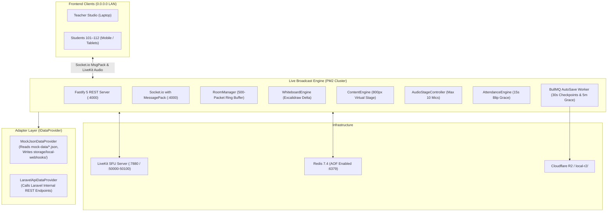

# Live Broadcast & Attendance Engine Microservice

Production-grade, horizontally scalable, real-time learning page broadcasting and student attendance microservice. Built with **Node.js 24 LTS**, **TypeScript**, **Fastify 5.x**, **Socket.io 4.8+** with binary **MessagePack** encoding, **Redis 7.4** state & sequence ring-buffer, **BullMQ** background queues, and **LiveKit SFU** two-way audio stage.

---

## 1. System Architecture & Zero-Refactor Adapter Pattern

The microservice operates in two interchangeable modes controlled by a single environment variable:

```bash
DATA_SOURCE_MODE="mock_json" | "laravel_api"
```



### Modes Breakdown
- **`mock_json` (Default for Local Development & Testing):**
  - Uses static tokens for **1 Teacher** (`Prof. Anand Sharma`) and **12 Students** (`Rahul`, `Priya`, `Aman`, etc.).
  - Reads Chapters, Lessons, Topics, and 800px rich virtual content blocks directly from `mock-data/*.json`.
  - On session end or teacher grace timeout, dumps finalized attendance metrics to `storage/local-webhooks/session-summaries.json` and `storage/local-r2/sessions/{sessionId}/`.
- **`laravel_api` (Production Mode):**
  - Switches to `LaravelApiDataProvider` with **zero code modifications**.
  - Communicates with Laravel backend over secured internal HTTP API with `X-Internal-Secret` and Bearer authentication.

---

## 2. Core Mathematical Coordinate Models & Engines

### Formula A: Content Mode — 800px Virtual Page Scaling & Block-ID Anchoring
Never broadcast raw screen pixel positions. All content is placed in an $800\text{ px}$ logical container.

1. **Virtual Logical Width:**
   $$W_{\text{virtual}} = 800\text{ px}$$

2. **CSS Transform Scaling Factor on Device:**
   $$S_{\text{content}} = \frac{W_{\text{device}}}{800}$$

3. **Scroll Sync (Block-ID Anchoring):**
   $$\text{blockOffsetRatio} = \frac{\text{scrollTop}_{\text{teacher}} - \text{blockTop}}{\text{blockHeight}} \in [0, 1]$$

4. **Virtual Space Pen & Laser Pointer Coordinates:**
   $$X_{\text{screen}} = X_v \times S_{\text{content}}, \quad Y_{\text{screen}} = (\text{blockTop}_{\text{student}} + Y_v) \times S_{\text{content}}$$

---

### Formula B: Excalidraw Infinite Canvas — Viewport Auto-Fit & Dynamic Zoom
The canvas spans $(-\infty, +\infty)$.

1. **Teacher Camera State:**
   $$\text{TeacherCam} = \{ C_x, C_y, Z_t, W_t, H_t \}$$

2. **Teacher Visible World Dimensions:**
   $$W_{\text{world}} = \frac{W_t}{Z_t}, \quad H_{\text{world}} = \frac{H_t}{Z_t}$$

3. **Student Auto-Fit Zoom ($Z_{\text{autofit}}$):**
   $$Z_{\text{autofit}} = \min\left(\frac{W_s}{W_{\text{world}}}, \frac{H_s}{H_{\text{world}}}\right)$$

4. **Student Effective Zoom with Custom Comfort Multiplier $M_{\text{student}} \in [0.5, 3.0]$:**
   $$Z_{\text{effective}} = Z_{\text{autofit}} \times M_{\text{student}}$$

5. **Follow Teacher vs Free Explore (Lerp Smooth Panning):**
   $$\text{CameraCenter}_{\text{next}} = \text{CameraCenter} + (\text{TeacherCursor} - \text{CameraCenter}) \times \alpha \quad (\alpha = 0.25)$$

---

### Formula C: Student Real-Time Attendance Engine
Tracks students in Redis hash `room:{sessionId}:attendance:{userId}`.

1. **Network Blip Grace (15 Seconds):**
   If a student disconnects and returns in $\le 15\text{s}$, the disconnection is merged into the current segment without gap.
2. **Heartbeat Validation (30 Seconds):**
   Students send a lightweight heartbeat every $30\text{s}$. If a browser crashes abruptly, their session ends at `lastSeenAt`.
3. **Session Metric Calculations:**
   $$\text{TotalJoinedSeconds} = \sum_{i=1}^{n} \left(\text{leftAt}_i - \text{joinedAt}_i\right)$$
   $$\text{AttendancePercentage} = \min\left(100, \text{round}\left(\frac{\text{TotalJoinedSeconds}}{\text{TotalClassDurationSeconds}} \times 100, 2\right)\right)$$
   - **`present`**: $\ge 75\%$
   - **`partial`**: $30\% \le \text{Percentage} < 75\%$
   - **`absent` / `late`**: $< 30\%$

---

## 3. Port & Service Network Mapping Table

| Port | Protocol | Component | Function |
| :--- | :--- | :--- | :--- |
| **`4000`** | TCP (HTTP/WS) | Broadcast Engine | Fastify REST API & Socket.io MsgPack engine |
| **`3000`** | TCP (HTTP) | Next.js Frontend | Learning Studio UI |
| **`6379`** | TCP | Redis 7.4 | Ring buffers, Attendance, BullMQ state |
| **`7880`** | TCP (HTTP/WS) | LiveKit SFU | WebRTC signaling & RoomService API |
| **`7881`** | TCP | LiveKit SFU | WebRTC TCP fallback |
| **`7882`** | UDP | LiveKit SFU | WebRTC UDP signaling |
| **`50000–50100`** | UDP | LiveKit SFU | WebRTC Audio Media Traffic Range |

---

## 4. REST API Endpoint Reference

### Headers
- `Authorization: Bearer <TOKEN>` (or query `?token=<TOKEN>`)
- `Content-Type: application/json`

### Endpoints

| Method | Endpoint | Description | Auth Required |
| :--- | :--- | :--- | :--- |
| `GET` | `/health` | Service health & active mode | No |
| `GET` | `/api/v1/dev/users` | List teacher & 12 student dev tokens | No |
| `GET` | `/api/v1/curriculum/:courseId` | Curriculum hierarchy (Chapters -> Lessons -> Topics) | No |
| `GET` | `/api/v1/lessons/:lessonId/content` | 800px Virtual Stage blocks | No |
| `POST` | `/api/v1/sessions/init` | Join/initialize session, receive LiveKit token | Yes |
| `GET` | `/api/v1/sessions/:sessionId/state` | Full room snapshot (whiteboard, cam, content) | No |
| `POST` | `/api/v1/sessions/:sessionId/audio/grant` | Approve student mic (enforces $\le 10$ limit) | Teacher |
| `POST` | `/api/v1/sessions/:sessionId/audio/mute` | Mute individual student | Teacher |
| `POST` | `/api/v1/sessions/:sessionId/audio/mute-all` | Emergency mute all students | Teacher |
| `POST` | `/api/v1/sessions/:sessionId/audio/raise-hand` | Student raises hand | Student |
| `POST` | `/api/v1/sessions/:sessionId/audio/lower-hand` | Student lowers hand | Student / Teacher |
| `POST` | `/api/v1/sessions/:sessionId/end` | Explicitly end live lecture | Teacher |
| `GET` | `/api/v1/sessions/:sessionId/attendance` | Live attendance metrics & calculations | No |

---

## 5. Socket.io Event Specification (MessagePack Binary Encoded)

### Client to Server (`emit`)
- `JOIN_ROOM`: `{ sessionId, lastSeqId }`
- `HEARTBEAT`: Ping sent every 30s by student
- `MODE_CHANGE`: `{ mode: 'CONTENT' | 'WHITEBOARD' | 'ROUGH_PAD' }` (Teacher only)
- `TEACHER_CAM_UPDATE`: `{ Cx, Cy, Zt, Wt, Ht }` (Teacher only)
- `WHITEBOARD_DELTA`: `{ elements: ExcalidrawElement[] }` (Teacher only)
- `SEND_TO_WHITEBOARD`: `{ block: ContentBlock }` (Teacher only)
- `CONTENT_SCROLL_SYNC`: `{ activeBlockId, blockOffsetRatio }` (Teacher only)
- `NAV_STATE_CHANGE`: `{ activeLessonId, activeTopicId }` (Teacher only)
- `CONTENT_STROKE_ADD`: `{ stroke: ContentStroke }` (Teacher only)
- `CONTENT_STROKES_CLEAR`: `{ lessonId }` (Teacher only)
- `CONTENT_LASER_MOVE`: `{ x, y, active }` (Teacher only)
- `AUDIO_RAISE_HAND`: Request microphone (Student)
- `AUDIO_LOWER_HAND`: Dismiss request (Student / Teacher)
- `AUDIO_GRANT_MIC`: `{ studentId, forceReplaceOldest?: boolean }` (Teacher)
- `AUDIO_MUTE_STUDENT`: `{ studentId }` (Teacher)
- `AUDIO_MUTE_ALL`: Emergency mute (Teacher)

### Server to Client (`on`)
- `ROOM_JOINED`: `{ sessionId, user, onlineCount }`
- `FULL_SNAPSHOT`: Full room snapshot if client missed $> 500$ packets
- `MISSED_PACKETS_REPLAY`: Replay delta packets from ring buffer
- `MODE_CHANGE`: Room switched mode
- `TEACHER_CAM_UPDATE`: Updated camera world coordinates
- `WHITEBOARD_DELTA`: Array of newly edited elements (version-map merged)
- `CONTENT_SCROLL_SYNC`: Anchored block & scroll ratio
- `NAV_STATE_CHANGE`: Switched active lesson & topic
- `CONTENT_STROKE_ADD`: Commits pen stroke in 800px space
- `CONTENT_STROKES_CLEAR`: Clears pen strokes
- `CONTENT_LASER_MOVE`: Real-time laser position
- `TEACHER_STATUS_CHANGE`: `LIVE` vs `TEACHER_RECONNECTING` (Grace Timer)
- `SESSION_ENDED`: Concluded session
- `ATTENDANCE_METRICS_UPDATE`: `{ onlineCount, joinedUser?, leftUser? }`
- `AUDIO_HAND_RAISED`: Raised hand added to queue
- `AUDIO_HAND_LOWERED`: Raised hand dismissed
- `AUDIO_MIC_GRANTED`: Mic permission issued to student
- `AUDIO_MIC_REVOKED`: Mic permission revoked
- `AUDIO_MUTE_ALL`: All student mics muted
- `AUDIO_ERROR`: Validation error when $\ge 10$ mics limit is reached

---

## 6. PM2 Cluster & Local Testing Commands

### PM2 Commands
```bash
# Start in multi-core cluster mode (-i max)
pm2 start ecosystem.config.cjs

# Real-time dashboard monitor
pm2 monit

# View streaming logs
pm2 logs live-broadcast-engine

# Stop service
pm2 stop ecosystem.config.cjs
```

### Docker Compose
```bash
# Run all background services (Redis, LiveKit SFU, Broadcast Engine)
docker compose -f docker-compose.broadcast.yml up -d

# Check running container health
docker compose -f docker-compose.broadcast.yml ps
```
